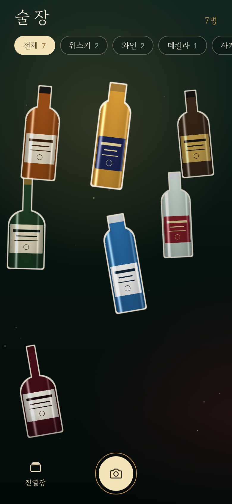
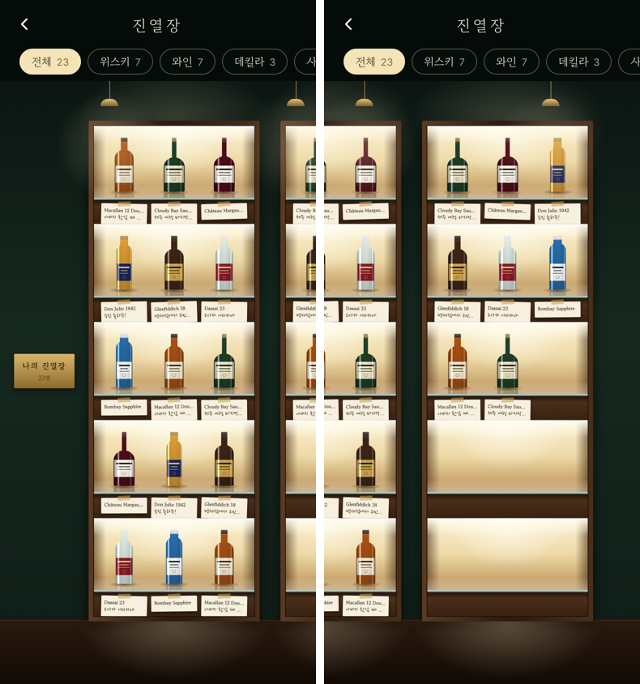
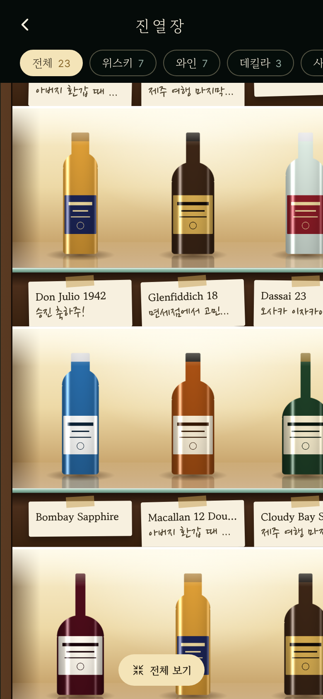

# 술장 — digital liquor showcase

버리기 아까운 술병을 찍으면 병만 떼어 내 모아 두는 앱. 모은 병은 홈에서 떠다니고, 진열장에서는 조명 선반에 메모지와 함께 놓인다.

| 홈 | 진열장 | 확대 |
| --- | --- | --- |
|  |  |  |

(미리보기의 병은 화면 확인용 더미 그림)

## 스택

- Expo SDK 58 · React Native 0.88 · expo-router · TypeScript
- 상태: zustand + AsyncStorage (기기 로컬 저장, 서버·로그인 없음)
- 병 떼어 내기: 로컬 Expo 모듈 `modules/subject-lift`
  - iOS 17+: Vision `VNGenerateForegroundInstanceMaskRequest`
  - Android: ML Kit Subject Segmentation
- 종류·이름 추정(선택): `supabase/functions/classify-bottle` → Claude 비전

## 실행

네이티브 모듈이 있어 Expo Go로는 안 되고 개발 빌드가 필요하다.

```bash
npm install
npx expo run:ios --device     # 실기기. 시뮬레이터는 Vision 피사체 분리가 안 돼 사진 그대로 담긴다
npx expo run:android
```

화면만 볼 때는 `npx expo start --web`.

### 처음 켜서 확인할 것

1. 빈 홈에서 **개발용: 샘플 병 18개 채우기**를 누르면 더미 병이 들어온다 (개발 빌드에만 보이는 버튼, 홈 오른쪽 아래 "샘플 지우기"로 제거).
2. 홈: 병이 화면 안을 떠다니는지, 종류 필터가 모은 종류만 나오는지.
3. 진열장: 옆으로 밀어 걷기, 두 손가락 확대, 두 번 눌러 확대·전체 보기.
   병을 길게 눌러 다른 칸으로 옮기기, 오른쪽 위 공유 버튼으로 이미지 저장·공유.
4. 실기기에서 병 하나 촬영 → 병만 떼어지는지, 홈에서 테두리 스티커로 튀어나오는지.
5. 빌드가 `modules/subject-lift`에서 깨지면 그 오류 로그부터.

## AI 분류 켜기

Supabase 프로젝트 `ieafmosojnvcveqawnmz`에 함수를 올리면 된다. 테이블·로그인은 필요 없다.

```bash
npx supabase login
npx supabase link --project-ref ieafmosojnvcveqawnmz
npx supabase secrets set ANTHROPIC_API_KEY=sk-ant-...   # console.anthropic.com에서 발급
npx supabase functions deploy classify-bottle
cp .env.example .env                                     # URL과 publishable 키가 이미 들어 있다
```

`.env`를 바꾼 뒤에는 개발 서버를 다시 켠다. URL이 비어 있거나 호출이 실패하면 종류와 이름을 직접 적는다.

## 구조

```
src/app/index.tsx        홈 — 떠다니는 병, 종류 필터(모은 종류만 생김)
src/app/capture.tsx      촬영 → 병 떼어 내기 → 이름·종류·메모 → 담기
src/app/cabinet.tsx      진열장 — 옆으로 이어지는 5단 장, 밀어서 걷기·확대
src/app/bottle/[id].tsx  병 상세·수정·삭제
src/store.ts             병 목록 저장
modules/subject-lift     피사체 분리 네이티브 모듈 (Swift / Kotlin)
supabase/functions       분류 함수
```

## 아직 확인 못 한 것

- `modules/subject-lift`의 Swift·Kotlin 코드는 실기기 빌드로 검증하지 않았다. 첫 `expo run:ios`에서 컴파일 오류가 나면 여기부터 본다.
- 분류 함수는 배포·호출 테스트 전.
- 진열장 이미지 저장·공유(`react-native-view-shot`)는 실기기에서만 확인할 수 있다.
