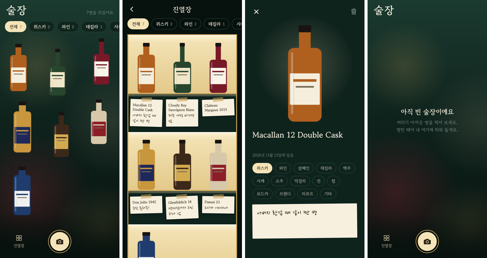

# 술장 — digital liquor showcase

버리기 아까운 술병을 찍으면 병만 떼어 내 모아 두는 앱. 모은 병은 홈에서 떠다니고, 진열장에서는 조명 선반에 메모지와 함께 놓인다.



(미리보기의 병은 화면 확인용 더미 그림)

## 스택

- Expo SDK 58 · React Native 0.88 · expo-router · TypeScript
- 상태: zustand + AsyncStorage (기기 로컬 저장, 서버·로그인 없음)
- 병 떼어 내기: 로컬 Expo 모듈 `modules/subject-lift`
  - iOS 17+: Vision `VNGenerateForegroundInstanceMaskRequest`
  - Android: ML Kit Subject Segmentation
- 종류·이름 추정(선택): `supabase/functions/classify-bottle` → Claude 비전

## 실행

네이티브 모듈이 있어 Expo Go로는 안 되고 개발 빌드가 필요하다.

```bash
npm install
npx expo run:ios --device     # 실기기. 시뮬레이터는 Vision 피사체 분리가 안 돼 사진 그대로 담긴다
npx expo run:android
```

화면만 볼 때는 `npx expo start --web`.

## AI 분류 켜기 (선택)

```bash
supabase functions deploy classify-bottle
supabase secrets set ANTHROPIC_API_KEY=sk-ant-...
cp .env.example .env   # EXPO_PUBLIC_CLASSIFY_URL, EXPO_PUBLIC_CLASSIFY_KEY(anon key) 채우기
```

URL이 비어 있으면 종류와 이름을 직접 고른다.

## 구조

```
src/app/index.tsx        홈 — 떠다니는 병, 종류 필터(모은 종류만 생김)
src/app/capture.tsx      촬영 → 병 떼어 내기 → 이름·종류·메모 → 담기
src/app/cabinet.tsx      진열장 — 조명 선반 + 메모지
src/app/bottle/[id].tsx  병 상세·수정·삭제
src/store.ts             병 목록 저장
modules/subject-lift     피사체 분리 네이티브 모듈 (Swift / Kotlin)
supabase/functions       분류 함수
```

## 아직 확인 못 한 것

- `modules/subject-lift`의 Swift·Kotlin 코드는 실기기 빌드로 검증하지 않았다. 첫 `expo run:ios`에서 컴파일 오류가 나면 여기부터 본다.
- 분류 함수는 배포·호출 테스트 전.
