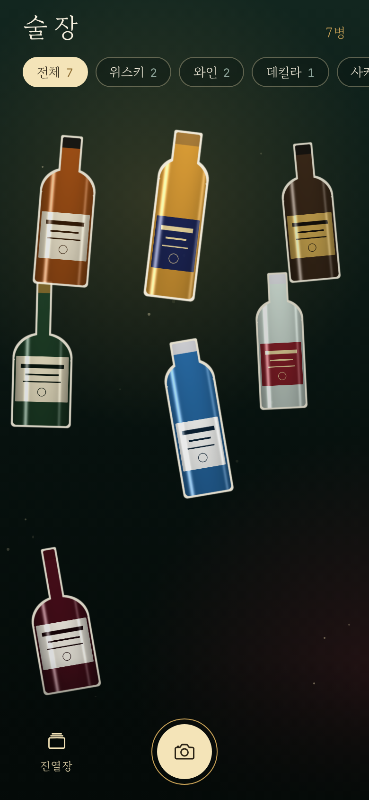
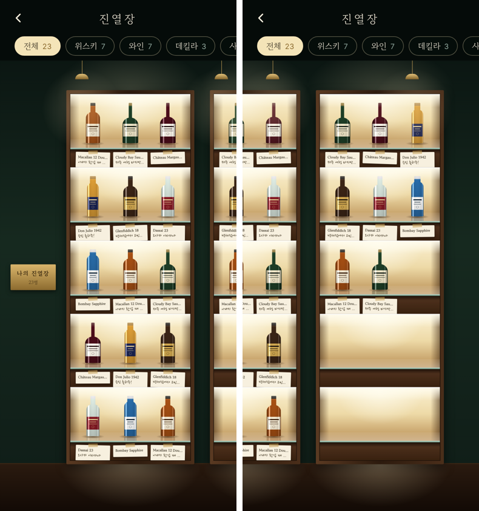
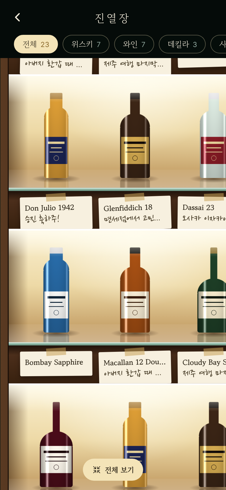

# 술장 — digital liquor showcase

버리기 아까운 술병을 찍으면 병만 떼어 내 모아 두는 앱. 모은 병은 홈에서 떠다니고, 진열장에서는 조명 선반에 메모지와 함께 놓인다.

| 홈 | 진열장 | 확대 |
| --- | --- | --- |
|  |  |  |

(미리보기의 병은 화면 확인용 더미 그림)

## 스택

- Expo SDK 58 · React Native 0.88 · expo-router · TypeScript
- 상태: zustand + AsyncStorage (기기 로컬 저장, 서버·로그인 없음)
- 병 떼어 내기: 로컬 Expo 모듈 `modules/subject-lift`
  - iOS 17+: Vision `VNGenerateForegroundInstanceMaskRequest`
  - Android: ML Kit Subject Segmentation
- 종류·이름 추정(선택): `supabase/functions/classify-bottle` → Claude 비전

## 실행

네이티브 모듈이 있어 Expo Go로는 안 되고 개발 빌드가 필요하다.

```bash
npm install
npx expo run:ios --device     # 실기기. 시뮬레이터는 Vision 피사체 분리가 안 돼 사진 그대로 담긴다
npx expo run:android
```

화면만 볼 때는 `npx expo start --web`.

### 처음 켜서 확인할 것

1. 빈 홈에서 **개발용: 샘플 병 18개 채우기**를 누르면 더미 병이 들어온다 (개발 빌드에만 보이는 버튼, 홈 오른쪽 아래 "샘플 지우기"로 제거).
2. 홈: 병이 화면 안을 떠다니는지, 종류 필터가 모은 종류만 나오는지.
3. 진열장: 옆으로 밀어 걷기, 두 손가락 확대, 두 번 눌러 확대·전체 보기.
   병을 길게 눌러 다른 칸으로 옮기기, 오른쪽 위 공유 버튼으로 이미지 저장·공유.
4. 실기기에서 병 하나 촬영 → 병만 떼어지는지, 홈에서 테두리 스티커로 튀어나오는지.
5. 빌드가 `modules/subject-lift`에서 깨지면 그 오류 로그부터.

## AI 분류 켜기

Supabase 프로젝트 `ieafmosojnvcveqawnmz`에 함수를 올리면 된다. 테이블·로그인은 필요 없다.

```bash
npx supabase login
npx supabase link --project-ref ieafmosojnvcveqawnmz
npx supabase secrets set ANTHROPIC_API_KEY=sk-ant-...   # console.anthropic.com에서 발급
npx supabase functions deploy classify-bottle
cp .env.example .env                                     # URL과 publishable 키가 이미 들어 있다
```

`.env`를 바꾼 뒤에는 개발 서버를 다시 켠다. URL이 비어 있거나 호출이 실패하면 종류와 이름을 직접 적는다.

## 로그인 (Apple · Google)

앱은 처음에 익명 사용자로 시작하고, 로그인 화면(`src/app/login.tsx`)에서 Apple·Google 계정을 **연결**한다. 사용자 id가 그대로라 산 테마·기록이 이어진다. 그 계정이 이미 다른 사용자(예: 예전 폰)에 연결돼 있으면 그 사용자로 로그인한다.

- iOS: Apple(기기 로그인 시트) + Google(브라우저 로그인 창)
- Android: Google
- 계정 삭제: 로그인 화면의 "계정 삭제" → `delete-account` 함수 (App Store 심사 요구사항)

### 한 번만 하는 설정

1. **Supabase → Authentication → Sign In / Providers**
   - **Allow manual linking** 켜기 (익명 사용자에 계정을 연결하려면 필요)
   - **Apple** 켜기 → Client IDs에 `kr.dragonite.suljang` (앱 안 로그인만 쓰므로 Secret Key는 비워도 된다)
   - **Google** 켜기 → 아래 2번에서 만든 Client ID·Client Secret 입력
2. **Google Cloud Console** → API 및 서비스 → OAuth 동의 화면 설정 → 사용자 인증 정보 → OAuth 클라이언트 ID 만들기
   - 유형: **웹 애플리케이션**
   - 승인된 리디렉션 URI: `https://ieafmosojnvcveqawnmz.supabase.co/auth/v1/callback`
3. **Supabase → Authentication → URL Configuration → Redirect URLs**에 `suljang://**` 추가
4. 서버 반영: `npx supabase db push --remote` → `npx supabase functions deploy delete-account`
5. 앱 다시 빌드: `npx expo run:ios --device` (Apple 로그인 모듈이 새로 들어감)

Apple Developer 쪽 Sign in with Apple 권한은 Xcode 자동 서명이 App ID에 켜 준다. 안 켜지면 developer.apple.com → Identifiers → `kr.dragonite.suljang` → Sign In with Apple 체크.

## 디자인 에셋

받은 원본은 `design/source/`, 앱이 쓰는 파일은 `assets/ui/`에 있다. 원본을 바꾸면 스크립트로 다시 만든다.

| 파일 | 만드는 방법 |
|---|---|
| `shelf.png` + `src/components/cabinet/shelf.json` | `python3 scripts/make-shelf.py [가로 배율] [원목 띠 배율]` — 진열장을 넓히고 칸 좌표를 함께 저장 |
| `splash.png`, `paper.png`, `camera.png`, `cabinet.png`, 앱 아이콘(`assets/icon.png`, Android 적응형) | `python3 scripts/make-ui-assets.py` |
| `assets/themes/<테마>.jpg` (테마 미리보기) | `python3 scripts/make-theme-assets.py` — 라벨 글자·문장을 뭉갬 |

스플래시 문구는 `src/components/Intro.tsx`의 `INTRO_LINES`, 손글씨 글꼴은 `assets/fonts/SongleSongeulHeullim.ttf`(그리운X국한박 송글손글 감성 흘림체, 파일 수정 금지)다.

## 서버 준비 (익명 로그인·테이블)

앱은 가입 화면 없이 기기마다 익명 사용자로 로그인하고, 함수는 그 사용자 토큰이 있어야 응답한다.

1. 대시보드 Authentication → Sign In / Providers → **Allow anonymous sign-ins** 켜기
2. 테이블·저장소 만들기: `npx supabase db push --remote`
3. 함수 다시 올리기: `npx supabase functions deploy classify-bottle illustrate-bottle`

순서를 지켜야 한다. 1번 전에 3번을 하면 앱이 로그인하지 못해 분류·그림이 실패한다(직접 입력으로 넘어간다).

## 수채화 그리기 켜기

찍은 병을 이미지 모델로 다시 그린다. 기본은 Cloudflare AI Gateway를 거친 Google 나노바나나(Cloudflare 크레딧 결제).

```bash
npx supabase secrets set CF_ACCOUNT_ID=... CF_API_TOKEN=...
npx supabase functions deploy illustrate-bottle
```

### 그림 모델 바꾸기

모델 호출은 `supabase/functions/illustrate-bottle/providers/`에 모델별로 나뉘어 있다. 한도 초과(429)나 서버 오류(5xx)는 최대 3번까지만 다시 시도한다.

| 값 | 설명 | 필요한 시크릿 |
|---|---|---|
| `cloudflare` (기본) | Cloudflare 경유 나노바나나. `ILLUSTRATE_TRY_FLUX=1`이면 FLUX부터 시도 | `CF_ACCOUNT_ID`, `CF_API_TOKEN` |
| `google` | Gemini API 직접 호출 (수수료 없음) | `GOOGLE_API_KEY`, 선택 `GOOGLE_IMAGE_MODEL` |

```bash
npx supabase secrets set ART_PROVIDER=google          # 전체
npx supabase secrets set ART_PROVIDER_MONET=google    # 테마 하나만
```

함수 테스트(실제 모델을 부르지 않아 비용 없음): `deno test -A supabase/functions/_tests`

### 그림 프롬프트 바꾸기

코드를 고치지 않고 Supabase 시크릿으로 테마별 프롬프트를 덮어쓸 수 있다. 공통 지시(병 모양 유지·흰 배경 등)는 `PROMPT_KEEP`.

```bash
npx supabase secrets set PROMPT_WATERCOLOR="Redraw the bottle as ..."
npx supabase secrets unset PROMPT_WATERCOLOR   # 기본값으로 되돌리기
```

키 이름: `PROMPT_WATERCOLOR`, `PROMPT_MONET`, `PROMPT_VANGOGH`, `PROMPT_MODERN`, `PROMPT_KEEP`. 기본값은 `supabase/functions/illustrate-bottle/prompts.ts`에 있다. 이미지 모델은 진짜 투명 PNG를 만들지 못하므로 프롬프트는 흰 배경으로 받고, 앱이 기기에서 병만 떼어 낸다.

주소는 `EXPO_PUBLIC_CLASSIFY_URL`에서 함수 이름만 바꿔 쓴다. 실패하면 사진 누끼로 담고, 병 화면에서 다시 그릴 수 있다.

## 테마 미리보기 만들기

테마 고르기 화면의 미리보기는 실제 브랜드가 아닌 가상 병(MAISON LUNE)으로 만든다. 앱에 실제 상표를 넣어 배포하지 않기 위해서다.

```bash
python3 scripts/make-preview-bottle.py scripts/preview-bottle.jpg   # 가상 병 사진 (이미 들어 있음)
node scripts/make-theme-previews.mjs                                 # 4장 생성 → assets/themes/*.jpg (약 $0.16)
node scripts/make-theme-previews.mjs vangogh                         # 한 테마만 다시
```

## 구조

```
src/app/                 화면 (expo-router)
  index.tsx              홈 — 떠다니는 병, 종류 필터(모은 종류만 생김)
  capture.tsx            카메라·앨범
  cabinet.tsx            진열장 — 옮기기, 이미지 공유
  bottle/[id].tsx        병 상세·수정·삭제
src/components/
  FloatingField.tsx      홈의 떠다니는 병
  cabinet/               layout(치수·자리 배치) · Unit · Shelf · useRoomView(걷기·확대) · MoveContext
  capture/Review.tsx     떼어 낸 병 확인, 이름·종류·메모
src/lib/
  useCapture.ts          촬영 → 누끼 + 라벨 읽기 → 저장 흐름
  classify.ts            사진을 줄여 분류 함수 호출
  images.ts              병 이미지 파일 보관
src/store.ts             병 목록·자리 번호 저장 (zustand + AsyncStorage)
modules/subject-lift     피사체 분리 네이티브 모듈 (Swift / Kotlin)
supabase/functions       분류 함수
```

## 아직 확인 못 한 것

- `modules/subject-lift`의 Swift·Kotlin 코드는 실기기 빌드로 검증하지 않았다. 첫 `expo run:ios`에서 컴파일 오류가 나면 여기부터 본다.
- 분류 함수는 배포·호출 테스트 전.
- 진열장 이미지 저장·공유(`react-native-view-shot`)는 실기기에서만 확인할 수 있다.
